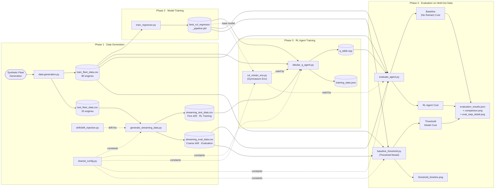
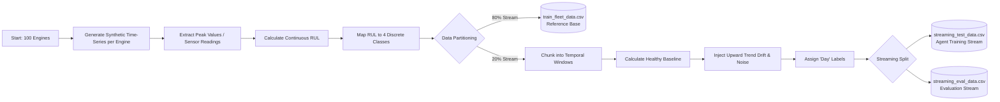
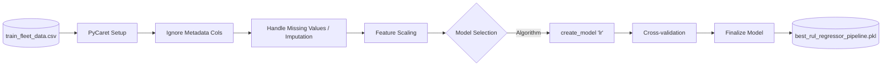
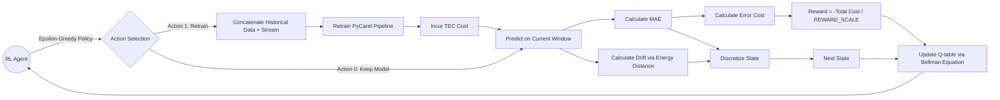

# RL Agent Configuration Summary

## Core RL configuration

| Category | Item | Configuration / Value |
|---|---|---|
| Value function | Algorithm | Tabular Q-Learning |
| Value function | Q-function | $Q(s,a)$ stores the expected return for state $s$ and action $a$ |
| Value function | Update rule | $Q(s,a) \leftarrow Q(s,a) + \alpha \, [r + \gamma \max_{a'} Q(s',a') - Q(s,a)]$ |
| Value function | Learning rate | $\alpha = 0.1$ |
| Value function | Discount factor | $\gamma = 0.95$ |
| Value function | Exploration policy | $\epsilon$-greedy |
| Value function | Epsilon schedule | Start $0.5$, end $0.05$, linear decay $0.023$ per episode |
| State space | Raw observation | 6 normalised features: drift, MAE, MAE change, age, MAE slope, cumulative cost |
| State space | Features used by the tabular agent | Drift, MAE, age / staleness |
| State space | Discretization | 3 bins per feature: Low / Medium / High |
| State space | Total discrete states | $3 \times 3 \times 3 = 27$ |
| State space | Drift bins | Low $< 0.18$, Medium $< 0.40$, High $\ge 0.40$ |
| State space | MAE bins | Low $< 0.39$, Medium $< 0.61$, High $\ge 0.61$ |
| State space | Age / staleness bins | Low $< 0.20$, Medium $< 0.50$, High $\ge 0.50$ |
| Action space | Action 0 | Do nothing, keep the current model |
| Action space | Action 1 | Retrain the model on all data seen so far |

## Cost and environment

| Category | Item | Configuration / Value |
|---|---|---|
| Cost function | Per-engine error cost | Mean prediction error $\le -100$ counts as UPC; mean prediction error $\ge 100$ counts as DC |
| Cost function | UPC | $100$ |
| Cost function | DC | $200$ |
| Cost function | Retrain cost | $TEC = 1500$ |
| Cost function | Infrastructure cost | $CIC = 10$/hr |
| Cost function | Reward | $r = -\,\text{step\_cost} / \text{REWARD\_SCALE}$ |
| Cost function | Reward scale | $4000$ |
| Environment | Window size | $DAY\_WINDOW = 10$ days |
| Environment | Max batches per episode | $25$ |
| Environment | Episodes | $20$ |
| Environment | Drift normalisation limit | $48526.17$ |
| Environment | MAE normalisation limit | $504.84$ |
| Environment | Age normalisation limit | $10$ windows |

## Data flow and file usage

| File | Role | Reads | Writes |
|---|---|---|---|
| `data-generation/data-generation.py` | Synthesises the fleet data | None | `data-generation/train_fleet_data.csv`, `data-generation/test_fleet_data.csv` |
| `data-generation/generate_streaming_data.py` | Builds drifted day-window streams from the held-out test split | `data-generation/test_fleet_data.csv`, `drift/evaluate_drift_impact.py`, `ml-models/shared_config.py` | `data-generation/streaming_test_data.csv`, `data-generation/streaming_eval_data.csv` |
| `ml-models/train_regressor.py` | Trains the baseline RUL regressor | `data-generation/train_fleet_data.csv`, `data-generation/test_fleet_data.csv` | `ml-models/results/best_rul_regressor_pipeline.pkl` |
| `ml-models/tabular_q_agent.py` | Trains the tabular RL agent | `data-generation/streaming_test_data.csv`, `data-generation/train_fleet_data.csv`, `ml-models/results/best_rul_regressor_pipeline.pkl`, `ml-models/shared_config.py` | `ml-models/results/q_table.npy`, `ml-models/results/training_stats.json` |
| `ml-models/evaluate_agent.py` | Evaluates baseline, threshold, and RL policies | `data-generation/train_fleet_data.csv`, `data-generation/streaming_eval_data.csv`, `ml-models/results/best_rul_regressor_pipeline.pkl`, `ml-models/results/q_table.npy` | `ml-models/results/evaluation_results.json`, comparison plots |
| `ml-models/baseline_threshold.py` | Runs the static drift/MAE threshold baseline | `data-generation/train_fleet_data.csv`, `data-generation/streaming_eval_data.csv`, `ml-models/results/best_rul_regressor_pipeline.pkl`, `ml-models/shared_config.py` | Threshold baseline metrics and plots |
| `ml-models/rul_retrain_env.py` | Environment used by the RL agent and evaluation scripts | `ml-models/results/best_rul_regressor_pipeline.pkl` and the streaming/reference DataFrames passed in at runtime | No standalone data file |
| `drift/evaluate_drift_impact.py` | Provides drift injection and energy-distance utilities | Used by `generate_streaming_data.py` and the evaluation scripts | No standalone data file |

## Slide-ready short version

| Item | Summary |
|---|---|
| Value/Q-function | Tabular Q-learning with $Q(s,a)$, Bellman update, $\alpha=0.1$, $\gamma=0.95$, $\epsilon$-greedy exploration |
| Cost function | Step cost = prediction error cost + retrain cost; reward is negative normalized step cost |
| States | 27 discrete states from 3 features: drift, MAE, age, each binned into Low/Medium/High |
| Actions | 0 = do nothing, 1 = retrain |
| Data | `data-generation.py` creates train/test CSVs; `generate_streaming_data.py` turns the held-out test split into `streaming_test_data.csv` and `streaming_eval_data.csv` |

## Mermaid flowchart

## Deep-Dive Component Architectures

### 1. Data Generation Layer (`data-generation.py` & `generate_streaming_data.py`)

### 2. Regressor Model Training (`train_regressor.py`)

### 3. RL Agent Architecture (`tabular_q_agent.py` & `rul_retrain_env.py`)

## Note

The markdown now follows the code in `ml-models/shared_config.py`, `data-generation/data-generation.py`, `data-generation/generate_streaming_data.py`, `ml-models/tabular_q_agent.py`, and `ml-models/rul_retrain_env.py`. The earlier documentation values for $TEC$, reward scale, and the streaming windowing scheme were outdated.