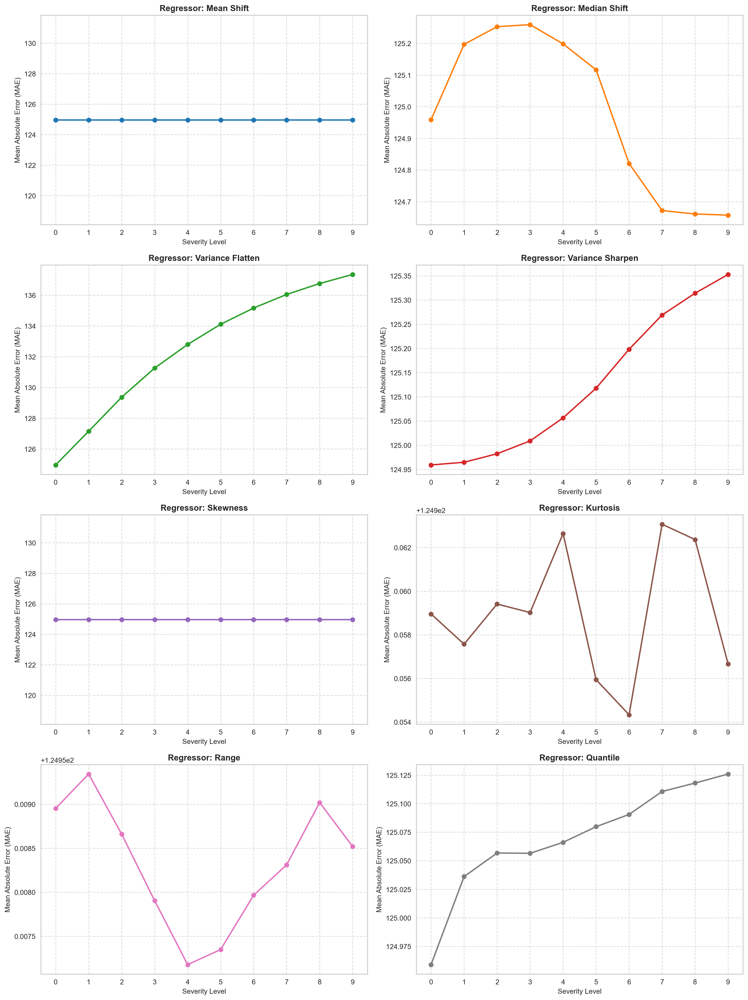
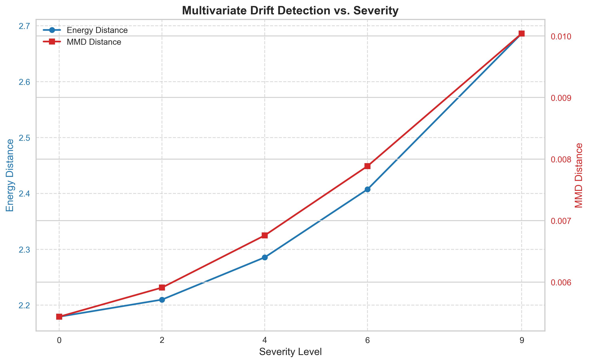
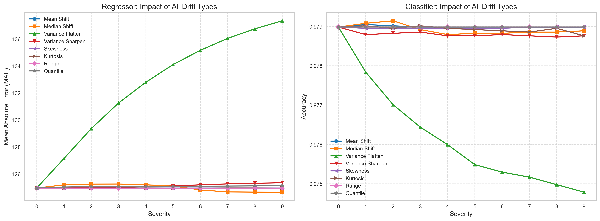
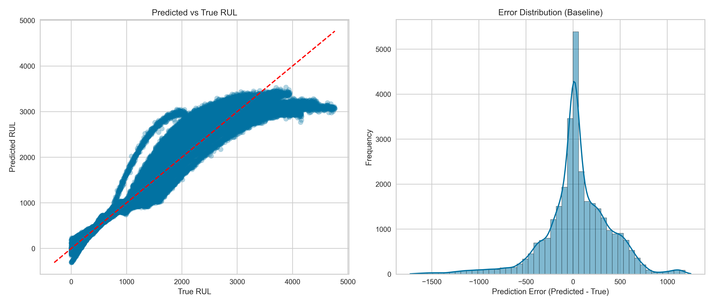
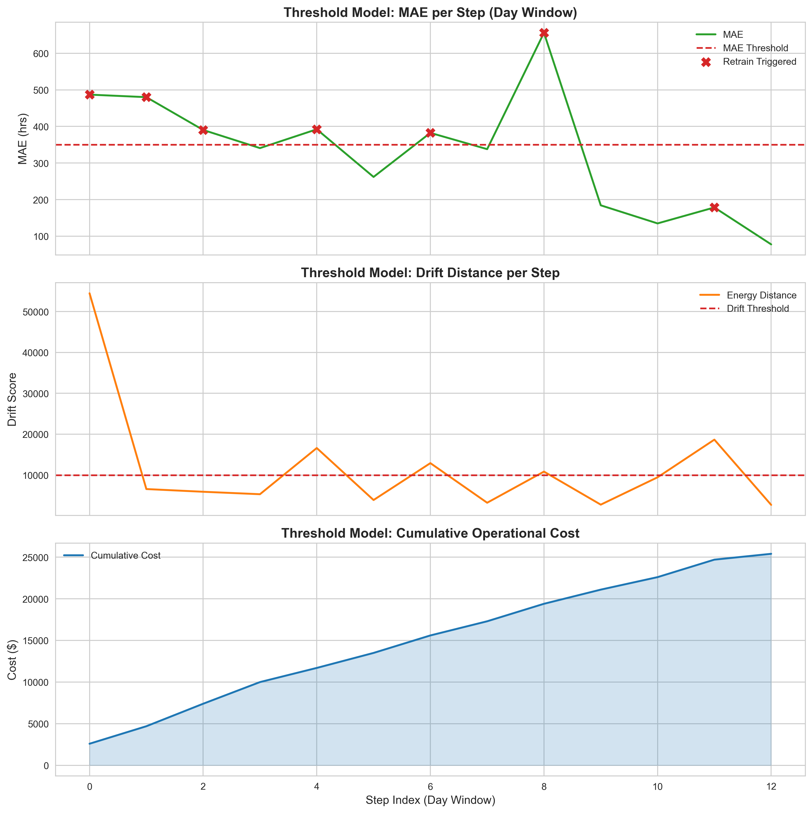
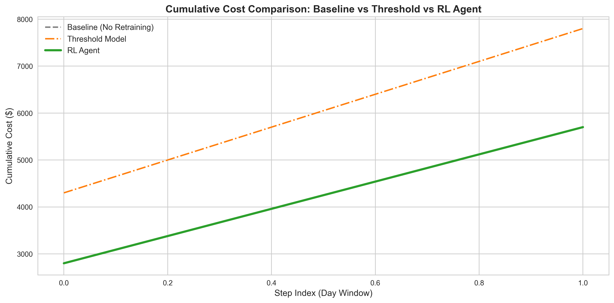
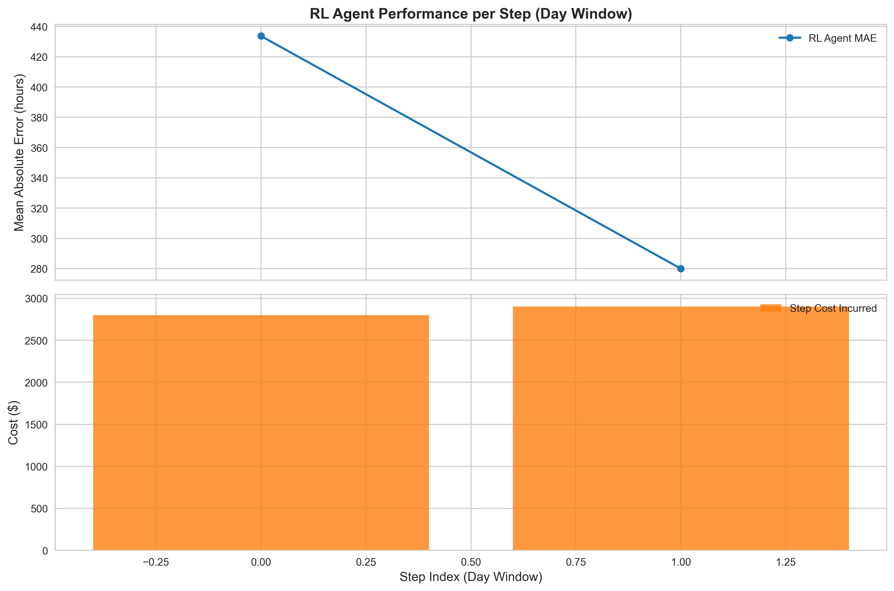

# Self-Adaptive Governance Framework for Deployed Sensor Prognostic Models

**Organisation:** Cummins Inc. — Advanced Analytics   
**Date:** 21 July 2026

---

## Table of Contents

1. [Problem Statement](#1-problem-statement)
2. [What is Data Drift](#2-what-is-data-drift)
3. [Data Generation](#3-data-generation)
4. [Drift Injection](#4-drift-injection)
5. [Drift Detection](#5-drift-detection)
6. [Solution: Reinforcement Learning](#6-solution-reinforcement-learning)
7. [Baseline Model](#7-baseline-model)
8. [Threshold Model](#8-threshold-model)
9. [RL Agent](#9-rl-agent)
10. [Cost Analysis and Results](#10-cost-analysis-and-results)
11. [Repository Structure](#11-repository-structure)
12. [Notation and Conventions](#12-notation-and-conventions)
13. [Key Assumptions](#13-key-assumptions)
14. [Future Work](#14-future-work)
15. [Concluding Thoughts](#15-concluding-thoughts)

---

## 1. Problem Statement

Deployed predictive Remaining Useful Life (RUL) models degrade in production due to **data drift** — systematic changes in sensor behaviour arising from sensor wear, operational regime shifts, and evolving environmental conditions. As the input distribution diverges from the training distribution, prediction errors compound over time.

Two economically distinct failure modes result from degraded predictions:

| Error Type | Condition | Consequence |
|---|---|---|
| **Over-prediction** (DC) | Predicted RUL > Actual RUL | Engine fails before scheduled maintenance. Unplanned downtime. |
| **Under-prediction** (UPC) | Predicted RUL < Actual RUL | Premature maintenance intervention. Unnecessary cost and uptime loss. |

The conventional remedy — periodic full model retraining — corrects prediction error but introduces its own cost: compute resources and engineering overhead. Retraining too frequently wastes resources; retraining too infrequently allows error costs to accumulate.

**Core problem:** A decision-making engine is required that determines *when* to retrain such that the objective of minimum total operational cost is achieved, explicitly trading off prediction error cost against retraining cost.

This report presents a proof-of-concept framework — implemented on synthetic Cummins-representative fleet data — that uses **Tabular Q-Learning** to learn this retraining policy.

---

## 2. What is Data Drift

### 2.1 Concept

Data drift refers to the statistical divergence between the distribution of data observed at training time ($P_{\text{train}}$) and the distribution of data arriving in production ($P_{\text{prod}}$) at time $t$:

$$P_{\text{prod}}(X_t) \neq P_{\text{train}}(X)$$

A model's learned decision boundary is a function of $P_{\text{train}}$. When $P_{\text{prod}}$ shifts, the mapping from inputs to outputs that was optimal at training time is no longer valid, and prediction error increases.

### 2.2 Types of Drift (Conceptual)

| Type | Description |
|---|---|
| **Covariate/Data Drift** | The input feature distribution $P(X)$ changes; the conditional label distribution $P(Y \mid X)$ remains stable. This is the primary drift type addressed in this project. |
| **Concept Drift** | The relationship $P(Y \mid X)$ itself changes — the underlying physics or process changes. |
| **Label Drift** | The marginal distribution of labels $P(Y)$ shifts (e.g., fleet ages, more engines entering low-RUL states). |

---

## 3. Data Generation

### 3.1 Why Synthetic Data

Cummins internal fleet data was not accessible. Synthetic data was generated using documented sensor statistics from two sources:

- Cummins-mapped parameter ranges (operational specifications)
- NASA CMAPSS benchmark dataset statistics for engine sensors

The generator (`data-generation/data-generation.py`) is fully parameterised and reproducible (`numpy.random.seed(42)`).

### 3.2 Fleet Configuration

| Parameter | Value |
|---|---|
| Total engines simulated | 100 |
| Vehicle speed range | 25 – 30 mph |
| Trip duration range | 1,800 – 14,400 seconds |
| Natural sensor drift ceiling | 15% of mean (quadratic wear model) |
| RUL | Computed from remaining engine-hours to end-of-life |

The natural in-data wear and tear follows a quadratic wear model:

$$\text{drift\_mag}(t) = \delta_{\max} \cdot \left(\frac{t}{T}\right)^2$$

where $t$ is cumulative engine runtime, $T$ is total engine life, and $\delta_{\max} = 0.15$.

### 3.3 Data Schema

Each row represents one trip for one engine. Sensors are stored as four per-trip aggregates: `_mean`, `_std`, `_min`, `_max`. The table below shows the reference distribution parameters for the 22 base sensor channels.

| Sensor Parameter | Mean | Std | Min | Max | Wear and Tear Direction |
|---|---|---|---|---|---|
| engine\_load | 31.80 | 17.20 | −5.20 | 104.50 | Increasing |
| fuel\_pressure | 548.20 | 285.60 | 0.00 | 735.80 | Stable |
| fuel\_level | 72.40 | 68.30 | −105.00 | 8970.20 | Decreasing |
| actuator\_position | 2.10 | 6.90 | −12.50 | 105.30 | Increasing |
| coolant\_temperature | 78.90 | 19.20 | −42.30 | 176.10 | Stable |
| emission\_index | 1.02 | 0.12 | 0.65 | 1.58 | Decreasing |
| filter\_load | 4.90 | 5.70 | −9.80 | 118.40 | Increasing |
| rail\_pressure | 1012.50 | 301.10 | −315.00 | 3150.50 | Decreasing |
| ambient\_pressure | 24.30 | 17.80 | −65.00 | 10250.00 | Stable |
| system\_voltage | 701.40 | 38.40 | 0.00 | 780.50 | Increasing |
| energy\_storage\_level | 76.80 | 19.50 | 0.00 | 101.80 | Decreasing |
| idle\_duration | 1425.00 | 7125.00 | 0.00 | 1,425,000.00 | Stable |
| fluid\_level | 73.50 | 23.70 | 0.00 | 104.20 | Decreasing |
| fluid\_dosing\_rate | 33.10 | 2.20 | 4.50 | 63.70 | Increasing |
| engine\_speed | 8677.55 | 374.66 | 7984.51 | 9244.59 | Decreasing |
| exhaust\_temperature | 1260.96 | 136.30 | 1023.77 | 1441.49 | Increasing |
| boost\_pressure | 359.73 | 174.13 | 136.17 | 570.81 | Decreasing |
| turbo\_speed | 2273.83 | 142.43 | 1914.72 | 2388.64 | Decreasing |
| air\_fuel\_ratio | 0.0252 | 0.0050 | 0.0200 | 0.0300 | Increasing |
| fuel\_rate | 338.79 | 164.19 | 128.31 | 537.49 | Increasing |
| intake\_pressure | 9.90 | 4.27 | 3.91 | 14.62 | Decreasing |
| ambient\_temperature | 485.84 | 30.42 | 445.00 | 518.67 | Increasing |

**Target variable:** `RUL` (continuous, hours).  
**Classification target:** `RUL_class` — `perfect` (>2000 h), `good` (1000–2000 h), `bad` (500–1000 h), `worse` (<500 h).

### 3.4 Dataset Splits

| Split | Engines | File | Purpose |
|---|---|---|---|
| Train | 1–60 | `train_fleet_data.csv` | Initial model training; reference distribution |
| Test | 61–80 | `test_fleet_data.csv` | Converted to test stream for RL agent training |
| Eval | 81–100 | `eval_fleet_data.csv` | Converted to eval stream for final evaluation |

### 3.5 Streaming Data and the Window Scheme

Streaming data simulates the real-world scenario where observations arrive incrementally over time. The test and eval sets are converted to streaming datasets via the following procedure (`generate_streaming_data.py`):

1. **Chunk division:** Each engine's trips are split into 21 equal chunks (index $i = 0, \ldots, 20$).
2. **Severity assignment:** Chunk $i$ receives drift severity $s_i = 0.5 \cdot i$, yielding $s \in \{0,\, 0.5,\, 1.0,\, \ldots,\, 10.0\}$. Severity zero is the clean reference distribution.
3. **Day labelling:** Synthetic `day` timestamps are assigned chronologically across chunks using `append_dfs_with_days`, producing a temporally ordered stream.
4. **Sorting:** The concatenated dataset is sorted by `day` to produce a monotonically advancing timeline.

The RL environment and all simulators process this stream in non-overlapping **day windows** of `DAY_WINDOW = 8` days per time step. At each step, the agent observes window statistics and decides whether to retrain.

> **Test Stream** (`streaming_test_data.csv`): Used for Q-table training.  
> **Eval Stream** (`streaming_eval_data.csv`): Held-out; used for final evaluation of all three approaches.

---

## 4. Drift Injection

### 4.1 Severity

Severity $s \in [0, 10]$ is a scalar controlling drift magnitude. At $s = 0$, no drift is applied. Each drift function is monotone increasing in $s$.

Eight distinct drift types are implemented, each targeting a specific statistical property on a designated sensor column.



*Figure 1: Regressor MAE vs. drift severity (0–9) for each individual drift type.*



*Figure 2: Energy Distance (left axis) and MMD Distance (right axis) vs. severity level.*

### 4.2 Eight Drift Types with Mathematical Formulas

Let $x$ denote original feature values, $\bar{x}$ the column mean, $\sigma_x$ the column standard deviation, $m$ the median, and $s$ the severity parameter.

---

**1. Mean Shift** — Applied to: `coolant_temperature_mean`

Shifts the entire distribution by a fraction of its standard deviation.

$$\delta = 0.5 \cdot \sigma_x$$

$$x' = x + s \cdot \delta$$

---

**2. Median Shift** — Applied to: `engine_load_mean`

Repositions the median while preserving approximate shape. Let $m' = m + s \cdot (0.3 \cdot \sigma_x)$.

For $x \leq m$:

$$x' = x \cdot \frac{m'}{m}, \quad m \neq 0$$

For $x > m$:

$$x' = m' + (x - m) \cdot \frac{\bar{x} - m'}{\bar{x} - m}$$

---

**3. Variance Flatten** — Applied to: `exhaust_temperature_mean`

Increases variance by stretching values away from the mean.

$$x' = \bar{x} + (x - \bar{x}) \cdot (1 + 0.15s)$$

---

**4. Variance Sharpen** — Applied to: `fuel_rate_mean`

Compresses values toward the mean, reducing spread.

$$\text{scale} = \max(1 - 0.08s,\ 0.05)$$

$$x' = \bar{x} + (x - \bar{x}) \cdot \text{scale}$$

---

**5. Skewness Drift** — Applied to: `fuel_pressure_mean`

Applies a power transformation to induce positive skew, then re-normalises to the original scale.

$$x_{\text{shift}} = x - \min(x) + 1, \quad \alpha = \frac{1}{1 + 0.2s}$$

$$x_{\text{pow}} = x_{\text{shift}}^{\,\alpha}$$

$$x' = \frac{x_{\text{pow}} - \mu_{x_{\text{pow}}}}{\sigma_{x_{\text{pow}}}} \cdot \sigma_x + \bar{x}$$

---

**6. Kurtosis Drift** — Applied to: `boost_pressure_mean`

Adds heavy-tailed noise from a Student's $t$-distribution with decreasing degrees of freedom as severity increases.

$$\nu = \max(30 - 3s,\ 2), \quad \varepsilon \sim t_{\nu}$$

$$x' = x + \varepsilon \cdot 0.1s \cdot \sigma_x$$

As $s$ increases, $\nu$ decreases toward 2, producing progressively heavier tails.

---

**7. Range Drift** — Applied to: `intake_pressure_mean`

Extends values beyond the 95th percentile, expanding the observed range.

$$p_{95} = \text{quantile}(x,\ 0.95), \quad \text{ext} = 1 + 0.08s$$

$$x' = \begin{cases} p_{95} + (x - p_{95}) \cdot \text{ext} & \text{if } x > p_{95} \\ x & \text{otherwise} \end{cases}$$

---

**8. Quantile Drift** — Applied to: `rail_pressure_mean`

Progressively shifts the upper quartile of the distribution.

$$q_{75} = \text{quantile}(x,\ 0.75), \quad q_{\text{shift}} = 0.25s \cdot \sigma_x$$

$$x' = \begin{cases} x + q_{\text{shift}} \cdot \dfrac{x - q_{75}}{x_{\max} - q_{75}} & \text{if } x > q_{75} \\ x & \text{otherwise} \end{cases}$$

---

## 5. Drift Detection

Two multivariate drift detectors were implemented. **Energy Distance** is the operational detector used by the RL environment and the threshold model. **MMD** was used for exploratory analysis to corroborate energy distance findings and characterise drift severity.

### 5.1 Energy Distance (Operational)

Given reference sample $X = \{x_i\}_{i=1}^{m}$ and current window sample $Y = \{y_j\}_{j=1}^{n}$, energy distance is:

$$\mathcal{E}(X, Y) = 2\,\mathbb{E}\|X - Y\| - \mathbb{E}\|X - X'\| - \mathbb{E}\|Y - Y'\|$$

Approximated empirically using pairwise Euclidean distances:

$$\mathcal{E}(X, Y) = \frac{2}{mn}\sum_{i,j}\|x_i - y_j\| - \frac{1}{m^2}\sum_{i,j}\|x_i - x_j\| - \frac{1}{n^2}\sum_{i,j}\|y_i - y_j\|$$

The result is non-negative (clipped at 0). $\mathcal{E} = 0$ indicates identical distributions. Inputs are subsampled to 500 points for computational tractability within the RL training loop.

**System usage:** At each time step, energy distance is computed between a 500-sample draw from the reference distribution and a 500-sample draw from the current window. The raw score is normalised by `DRIFT_MAX` (95th percentile of observed scores) to produce state feature $f_1$.

### 5.2 Maximum Mean Discrepancy — MMD (Exploratory Only)

MMD measures the distance between two distributions embedded in a Reproducing Kernel Hilbert Space (RKHS). Using an RBF kernel $k(x, y) = \exp\!\left(-\|x - y\|^2 / 2\sigma^2\right)$ with $\sigma$ selected via the median heuristic:

$$\text{MMD}^2(X, Y) = \frac{1}{m(m-1)}\sum_{i \neq j}k(x_i, x_j) + \frac{1}{n(n-1)}\sum_{i \neq j}k(y_i, y_j) - \frac{2}{mn}\sum_{i,j}k(x_i, y_j)$$

The `MMDDriftDetector` implementation issues a drift decision using three combined criteria evaluated on a permutation null distribution (1,000 permutations):

| Criterion | Condition |
|---|---|
| p-value | $p < 0.05$ |
| Distance | $\text{MMD} > \theta_{95}$ (95th percentile of null) |
| Z-score | $z = (\text{MMD}^2 - \mu_{\text{null}}) / \sigma_{\text{null}} > 3.0$ |

Severity classification by number of criteria triggered: 0 → no drift, 1 → weak, 2 → moderate, 3 → strong.

> **Note:** MMD requires an $O(N^2)$ kernel matrix computation and is not used in the production inference loop. Energy Distance was selected as the operational metric for its lower computational cost.

### 5.3 MAE Growth with Drift Severity



*Figure 3: MAE grows monotonically with drift severity across all 8 drift types. Each line represents one drift type applied in isolation.*

---

## 6. Solution: Reinforcement Learning

### 6.1 What is Reinforcement Learning

Reinforcement Learning (RL) is a framework for sequential decision-making under uncertainty. An **agent** interacts with an **environment** over discrete time steps. At each step, the agent observes the environment's current **state**, selects an **action**, receives a scalar **reward**, and transitions to a new state. The agent's objective is to learn a **policy** $\pi: \mathcal{S} \rightarrow \mathcal{A}$ that maximises the expected cumulative discounted reward.

RL is distinguished from supervised learning in that there is no labelled dataset of correct actions. The agent learns from the consequences of its own decisions — making it appropriate for retraining governance, where the optimal retraining schedule is not known a priori and depends on an evolving cost landscape.

### 6.2 Core Concepts

#### States ($\mathcal{S}$)

A state $s \in \mathcal{S}$ is a compact representation of the environment sufficient for the agent to make an informed decision. In this system, the state encodes the model's current prediction quality, the degree of distributional shift, and temporal context.

#### Actions ($\mathcal{A}$)

The action set is binary: $\mathcal{A} = \{0, 1\}$:

- $a = 0$: **Do Nothing** — the current model continues on the next window.
- $a = 1$: **Retrain** — trigger a full PyCaret pipeline refit on all data seen to date.

#### Value Function

The state-action value function (Q-function) quantifies the expected cumulative discounted reward of taking action $a$ in state $s$ and following policy $\pi$ thereafter:

$$Q^{\pi}(s, a) = \mathbb{E}_{\pi}\!\left[\sum_{k=0}^{\infty} \gamma^k r_{t+k+1} \;\middle|\; s_t = s,\, a_t = a\right]$$

where $\gamma \in [0, 1)$ is the discount factor controlling the weighting of immediate versus future rewards. The optimal Q-function satisfies the Bellman optimality condition (Section 6.3).

#### Exploration–Exploitation Tradeoff

During training, the agent must balance two competing imperatives:

- **Exploitation:** Act greedily — choose $\arg\max_{a} Q(s, a)$. Maximises reward based on current knowledge.
- **Exploration:** Act randomly — sample $a$ uniformly from $\mathcal{A}$. Enables discovery of states not yet visited, potentially revealing better long-term policies.

An agent that only exploits converges prematurely to a suboptimal policy. An agent that only explores never uses what it has learned. The $\varepsilon$-greedy strategy manages this tradeoff: explore with probability $\varepsilon$, exploit with probability $1 - \varepsilon$. $\varepsilon$ is annealed linearly over training episodes, shifting the balance from exploration early in training to exploitation as the Q-table matures.

### 6.3 Tabular Q-Learning

Tabular Q-Learning is a model-free RL algorithm that maintains an explicit lookup table $Q: \mathcal{S} \times \mathcal{A} \rightarrow \mathbb{R}$, updated via observed transitions. Model-free means no model of environment dynamics is required — the agent learns directly from experience.

#### Bellman Update

After observing transition $(s_t, a_t, r_t, s_{t+1})$:

$$Q(s_t, a_t) \leftarrow Q(s_t, a_t) + \alpha \Bigl[ \underbrace{r_t + \gamma \max_{a'} Q(s_{t+1}, a')}_{\text{TD target}} - Q(s_t, a_t) \Bigr]$$

The bracketed term is the **Temporal Difference (TD) error** — the discrepancy between the current Q-value estimate and the bootstrapped target. The learning rate $\alpha$ controls the step size toward the target.

#### $\varepsilon$-Greedy Action Selection

$$a_t = \begin{cases} \text{Uniform sample from } \mathcal{A} & \text{with probability } \varepsilon \\ \displaystyle\arg\max_{a}\, Q(s_t, a) & \text{with probability } 1 - \varepsilon \end{cases}$$

$\varepsilon$ decays linearly each episode:

$$\varepsilon_{e+1} = \max\!\left(\varepsilon_{\min},\ \varepsilon_e - \varepsilon_{\text{decay}}\right)$$

### 6.4 Mathematical Summary of the Reward Function

**Step cost:**

$$C_{\text{step},t} = C_{\text{error},t} + C_{\text{retrain},t}$$

**Error cost** (computed on the current window before any retrain takes effect):

$$C_{\text{error},t} = m_t \cdot \text{UPC} + n_t \cdot \text{DC}$$

where $m_t$ = engines with mean prediction error $\leq -100$ h (under-prediction), $n_t$ = engines with mean error $\geq +100$ h (over-prediction), and error $\varepsilon = \hat{y} - y$.

**Retrain cost:**

$$C_{\text{retrain},t} = \mathbb{1}[a_t = 1] \cdot \text{TEC}$$

**Normalised reward:**

$$r_t = -\frac{C_{\text{step},t}}{R_{\text{scale}}} = -\frac{m_t \cdot \text{UPC} + n_t \cdot \text{DC} + \mathbb{1}[a_t = 1] \cdot \text{TEC}}{R_{\text{scale}}}$$

The negative sign ensures the agent minimises cost. $R_{\text{scale}} = 2{,}000$ is a normalisation constant (derived from the worst-case error cost of a 20-engine window: $20 \times \text{DC} = \$4{,}000$, divided by 2).

---

## 7. Baseline Model

The baseline represents Cummins' current operational posture: **no retraining is performed** after initial deployment. The model trained on the original training distribution is applied as-is across all incoming streaming windows.

This is simulated by running the RL environment with `force_action_0=True` — the agent unconditionally selects $a = 0$. As drift severity increases through the stream, prediction error accumulates with no corrective mechanism.

The baseline establishes the upper bound on total operational cost and illustrates the financial consequence of the no-retrain posture as sensor distributions evolve.



*Figure 4: Left — predicted vs. true RUL (diagonal = perfect prediction). Right — prediction error distribution (predicted − true) on the static test set.*

---

## 8. Threshold Model

The threshold model is a static rule-based retraining strategy. A retraining event is triggered at step $t$ if either condition is breached:

$$\text{Retrain if:} \quad \text{MAE}_t > \theta_{\text{MAE}} \quad \text{or} \quad \mathcal{E}_t > \theta_{\text{drift}}$$

with $\theta_{\text{MAE}} = 350.0$ hours and $\theta_{\text{drift}} = 10{,}000.0$ (energy distance units), as defined in `shared_config.py`.

When triggered, the model is retrained on the combined reference data and all stream data seen to date. The drift reference distribution is updated to the current window.

This approach improves upon the baseline but has a structural limitation: the thresholds are fixed and cannot adapt to the evolving cost context. The agent cannot assess whether retraining *now* is worth the cost relative to projected future savings.



*Figure 5: Three-panel timeline for the threshold model on the eval stream. Red markers (✕) indicate the 7 retrain events triggered.*

---

## 9. RL Agent

### 9.1 Gymnasium Environment (`rul_retrain_env.py`)

The retraining problem is formalised as a Markov Decision Process and implemented as a custom `gymnasium.Env` subclass: `RULRetrainEnv`.

| MDP Component | Specification |
|---|---|
| State space $\mathcal{S}$ | $[0,1]^6$ continuous box (6 normalised features) |
| Action space $\mathcal{A}$ | Discrete $\{0,\, 1\}$ |
| Reward | $r_t = -C_{\text{step},t} / R_{\text{scale}}$ |
| Termination | All day windows consumed, or step index $\geq$ `MAX_BATCHES` |

### 9.2 Observation Space (6 Features)

At each step, the environment computes a 6-dimensional normalised observation vector $\mathbf{o}_t$:

| Index | Feature | Formula | Description |
|---|---|---|---|
| $f_1$ | Drift | $\text{clip}(\mathcal{E}_t / \mathcal{E}_{\max},\; 0, 1)$ | Normalised energy distance from reference |
| $f_2$ | MAE | $\text{clip}(\text{MAE}_t / \text{MAE}_{\max},\; 0, 1)$ | Normalised absolute prediction error |
| $f_3$ | $\Delta$ MAE | $\text{clip}\!\left(\frac{\text{MAE}_t - \text{MAE}_{t-1}}{\text{MAE}_{t-1}},\; -1, 1\right)$ | Relative MAE change (degradation rate) |
| $f_4$ | Age | $\text{clip}((t - t_{\text{last retrain}}) / \text{AGE}_{\max},\; 0, 1)$ | Staleness: steps since last retrain |
| $f_5$ | Slope | $\text{clip}(\hat{\beta}_1 / (0.1 \cdot \text{MAE}_{\max}),\; -1, 1)$ | OLS slope over last 5 MAE observations |
| $f_6$ | Cum. cost | $\text{clip}(C_{\text{episode}} / 10^6,\; 0, 1)$ | Normalised cumulative episode cost |

where $\mathcal{E}_{\max} = 48{,}526.17$ and $\text{MAE}_{\max} = 504.84$ are the 95th-percentile values observed during calibration runs.

### 9.3 State Discretisation for the Q-Table

Tabular Q-Learning requires a finite discrete state space. The 6-dimensional continuous observation is projected onto 3 features, each binned into 3 levels (Low / Medium / High), yielding $3^3 = 27$ discrete states.

> **Design note:** Only $f_1$ (drift), $f_2$ (MAE), and $f_4$ (age/staleness) are used for discretisation. Features $f_3$, $f_5$, and $f_6$ are computed and available in the observation but excluded from the Q-table due to computational constraints on Q-table size and training time in this POC phase. This is a noted limitation — see Section 14.

**Discretisation thresholds:**

| Feature | Low (bin = 0) | Medium (bin = 1) | High (bin = 2) |
|---|---|---|---|
| Drift $f_1$ | $< 0.18$ | $[0.18,\; 0.40)$ | $\geq 0.40$ |
| MAE $f_2$ | $< 0.39$ | $[0.39,\; 0.61)$ | $\geq 0.61$ |
| Age $f_4$ | $< 0.20$ | $[0.20,\; 0.50)$ | $\geq 0.50$ |

The Q-table is a $27 \times 2$ matrix stored as a `defaultdict`, initialising unseen states to $\mathbf{0}$.

### 9.4 Training Procedure

Training runs for `N_EPISODES = 35` episodes over the test stream. Each episode:

1. Environment is reset; the base model is restored from disk.
2. Agent steps through the stream window-by-window using $\varepsilon$-greedy action selection.
3. Q-table is updated via the Bellman equation after each transition.
4. $\varepsilon$ is decayed linearly after each episode.

A `max_retrain_rows = 300` cap on PyCaret refit data is applied during RL training to accelerate iteration. This cap is removed (`max_retrain_rows=None`) during final evaluation to use the full dataset.


*Figure 6: RL Agent Decision Flow (per time step) — Observe current window, compute features, discretise to state, select action, execute, compute cost, and apply Bellman update.*

### 9.5 Configuration Table (`shared_config.py`)

| Parameter | Variable | Value | Description |
|---|---|---|---|
| Under-prediction cost | `UPC` | \$100 | Per engine with mean error $\leq -100$ h (unnecessary maintenance) |
| Degradation cost | `DC` | \$200 | Per engine with mean error $\geq +100$ h (unexpected failure; 2x UPC as unplanned failures are operationally more costly) |
| Traditional engineering cost | `TEC` | \$100 | Compute cost per PyCaret retraining run |
| Cloud infrastructure cost | `CIC` | \$10/hr | Defined for future use; not currently applied in cost calculations |
| Learning rate | `ALPHA_RL` | 0.1 | Q-table update step size |
| Discount factor | `GAMMA` | 0.95 | Future reward weight |
| Initial epsilon | `EPSILON_START` | 0.8 | High initial exploration rate |
| Final epsilon | `EPSILON_END` | 0.05 | Minimum exploration floor |
| Epsilon decay | `EPSILON_DECAY` | 0.019 | Linear decay per episode |
| Training episodes | `N_EPISODES` | 35 | Total Q-learning training episodes |
| Day window | `DAY_WINDOW` | 8 | Days of data per RL time step |
| Max batches | `MAX_BATCHES` | 25 | Episode truncation limit |
| Drift normaliser | `DRIFT_MAX` | 48,526.17 | 95th percentile of observed energy distance |
| MAE normaliser | `MAE_MAX` | 504.84 | 95th percentile of observed MAE (hours) |
| Age normaliser | `AGE_MAX` | 10 | Maximum steps since last retrain |
| Reward scale | `REWARD_SCALE` | 2,000 | Reward normalisation denominator |
| Static drift threshold | `DRIFT_THRESHOLD_STATIC` | 10,000.0 | Threshold model: energy distance trigger |
| Static MAE threshold | `MAE_THRESHOLD_STATIC` | 350.0 | Threshold model: MAE trigger (hours) |

---

## 10. Cost Analysis and Results

### 10.1 RUL Error Classification

Per-engine mean prediction error for engine $k$ within window $t$:

$$\bar{\varepsilon}_k = \frac{1}{|T_k|}\sum_{j \in T_k} (\hat{y}_j - y_j)$$

| Classification | Condition | Cost Applied |
|---|---|---|
| Over-prediction (DC) | $\bar{\varepsilon}_k \geq +100$ h | \$200 per engine |
| Under-prediction (UPC) | $\bar{\varepsilon}_k \leq -100$ h | \$100 per engine |
| Acceptable | $-100 < \bar{\varepsilon}_k < +100$ h | None |

### 10.2 Total Episode Cost

$$C_{\text{total}} = \sum_{t=1}^{T} \left( m_t \cdot \text{UPC} + n_t \cdot \text{DC} + \mathbb{1}[a_t = 1] \cdot \text{TEC} \right)$$

### 10.3 Results on Eval Stream

All three approaches were evaluated on the held-out eval stream (`streaming_eval_data.csv`), which was not used during RL training.

| Model | Total Cost | Retrains | Savings vs. Baseline |
|---|---|---|---|
| Baseline (No Retraining) | \$31,000 | 0 | — |
| Threshold Model | \$25,400 | 7 | −\$5,600 (−18.1%) |
| **RL Agent** | **\$24,100** | **13** | **−\$6,900 (−22.3%)** |



*Figure 7: Cumulative operational cost over the eval stream. RL Agent (green) tracks below both the Baseline (grey dashed) and Threshold Model (orange dash-dot) throughout.*



*Figure 8: Top panel — MAE trajectory with red dashed lines marking the 13 retrain events. Bottom panel — per-step cost incurred.*

### 10.4 Interpretation

The RL agent achieves the lowest total cost by learning a context-sensitive retraining policy. Unlike the threshold model — which retrains reactively whenever MAE or drift breaches a fixed boundary — the RL agent accounts for model staleness, the rate of MAE growth, and long-term cost consequences via the discounted future reward in the Bellman update.

Critically, the RL agent does not classify the current state as "retrain" or "not retrain" based on point-in-time conditions. It estimates the value $Q(s, a)$ of each action under the expectation of future states, enabling it to defer unnecessary retrains when the cost savings are not projected to materialise and to act pre-emptively when degradation trends indicate impending high-cost windows.

---

## 11. Repository Structure

```
intern-cummins/
|
|-- data-generation/
|   |-- data-generation.py              # Fleet simulation; static dataset generation
|   |-- generate_streaming_data.py      # Drift injection; streaming dataset construction
|   |-- train_data_distribution_tests.py
|   |-- train_fleet_data.csv            # Reference training data (60 engines)
|   |-- test_fleet_data.csv             # Clean test data (engines 61-80)
|   |-- eval_fleet_data.csv             # Clean eval data (engines 81-100)
|   |-- streaming_test_data.csv         # Drifted test stream (RL agent training)
|   `-- streaming_eval_data.csv         # Drifted eval stream (final evaluation)
|
|-- drift/
|   |-- evaluate_drift_impact.py        # Drift injection functions, Energy Distance, MMD
|   |-- visualize_drift_distributions.py
|   `-- results/
|       |-- regressor_drifts_grid.png
|       |-- classifier_drifts_grid.png
|       |-- multivariate_drift_metrics.png
|       |-- drift_impact_summary.png
|       `-- all_drift_distributions.png
|
|-- ml-models/
|   |-- shared_config.py                # Canonical cost constants and hyperparameters
|   |-- train_regressor.py              # PyCaret linear regressor initial training
|   |-- train_classifier.py            # PyCaret RUL class classifier training
|   |-- phase0_baseline.py             # Static baseline evaluation (no retraining)
|   |-- rul_retrain_env.py             # Gymnasium MDP environment
|   |-- tabular_q_agent.py             # Q-learning agent and training loop
|   |-- baseline_threshold.py          # Static threshold retraining simulator
|   |-- evaluate_agent.py              # Final evaluation and comparison plots
|   |-- validate_env.py                # Gymnasium env sanity checker
|   `-- results/
|       |-- best_rul_regressor_pipeline.pkl   # Trained PyCaret regression pipeline
|       |-- q_table.npy                        # Trained Q-table
|       |-- evaluation_results.json            # Final cost comparison (JSON)
|       |-- comparison.png                     # Cumulative cost plot (all 3 models)
|       |-- eval_step_detail.png               # RL agent step-level detail plot
|       |-- threshold_timeline.png             # Threshold model MAE/drift/cost timeline
|       `-- model_baseline_performance.png     # Baseline scatter and error distribution
|
|-- requirements.txt
`-- report.md
```

### Linear Regressor (PyCaret)

The predictive model is a **linear regressor** (`'lr'`) trained via PyCaret. PyCaret automates the preprocessing pipeline (imputation, scaling, encoding) and wraps scikit-learn's `LinearRegression` in a serialisable pipeline object. The initial model is trained on `train_fleet_data.csv` with `Engine_number`, `trip_id`, and `RUL_class` excluded. The pipeline is serialised to `best_rul_regressor_pipeline.pkl`.

During retraining (triggered by the threshold model or RL agent), PyCaret's `setup` and `create_model('lr')` are re-run on the combined reference + stream-to-date data, replacing the working model file in place.

---

## 12. Notation and Conventions

| Symbol | Meaning |
|---|---|
| $s$ | Drift severity scalar, $s \in [0, 10]$ |
| $x,\, y$ | Feature vector (input), label (RUL in hours) |
| $\hat{y}$ | Model prediction |
| $\bar{\varepsilon}_k$ | Mean per-engine prediction error for engine $k$ |
| $m_t,\, n_t$ | UPC and DC engine counts at step $t$ |
| $\mathcal{E}(X, Y)$ | Energy distance between two sample distributions |
| $Q(s, a)$ | Q-value of state-action pair |
| $\alpha$ | Q-learning learning rate |
| $\gamma$ | Discount factor |
| $\varepsilon$ | Exploration probability in $\varepsilon$-greedy policy |
| $\pi$ | Policy mapping $\mathcal{S} \rightarrow \mathcal{A}$ |
| $R_{\text{scale}}$ | Reward normalisation denominator |
| UPC | Under-Prediction Cost (\$100/engine) |
| DC | Degradation Cost (\$200/engine) |
| TEC | Traditional Engineering Cost (\$100/retrain run) |

**Sign convention for error:** $\varepsilon = \hat{y} - y$.  
A positive error (over-prediction) implies the model predicts a longer remaining life than exists — the engine fails sooner than expected (DC).  
A negative error (under-prediction) implies premature maintenance (UPC).  
All cost figures are in USD.

---

## 13. Key Assumptions

1. **Linear regressor as proxy model:** A PyCaret `'lr'` model is used. In production, a more expressive model (gradient-boosted trees, neural network) would likely be deployed. The RL retraining framework is model-agnostic.

2. **Synthetic data as ideal-case proxy:** All experiments use synthetically generated data. Distributions are controlled and reproducible. Real-world data will contain additional noise sources, temporal correlations, missing values, and fault conditions not captured here.

3. **Fixed cost parameters:** UPC = \$100, DC = \$200, TEC = \$100 were set per stakeholder guidance (Rohit, Aman) and engineering intuition. These values are critical inputs to the agent's learned policy and must be calibrated against actual Cummins operational cost data before production use.

4. **TEC as compute cost only:** TEC represents the compute cost of a PyCaret refit. Engineer validation time required before deploying a retrained model is not modelled.

5. **Immediate model deployment:** The framework assumes a retrained model is immediately available for inference. Production staging, validation, and rollout pipelines would introduce deployment latency.

6. **Stationarity of cost model:** UPC, DC, and TEC are constant across all episodes and engines. In practice, failure costs vary by engine type, application criticality, and contractual terms.

7. **Energy distance as sufficient drift proxy:** A single global scalar is used to represent multivariate distributional shift. Localised drift in low-variance feature subspaces may not be adequately captured.

8. **DAY_WINDOW = 8:** Step granularity of 8 days is a design choice. Finer granularity increases action frequency and sensitivity but raises computational cost per training episode.

---

## 14. Future Work

|Improvement | Rationale |
|---|---|
| **Validate on real Cummins fleet telemetry** | Synthetic data is an idealised scenario. Production data may require cost parameter revision, feature engineering, and model architecture changes. |
| **Expand state space to include $f_3$ (Delta MAE), $f_5$ (slope), $f_6$ (cumulative cost)** | Only 3 of 6 computed features are used for Q-table discretisation. Rate-of-change and slope signals would enable earlier, more precise retrain decisions. Excluded in this POC due to Q-table size constraints. |
| **Transition to Deep Q-Network (DQN)** | A neural network function approximator eliminates manual state discretisation, scales to larger state spaces, and learns non-linear value functions. |
| **Hyperparameter optimisation** | $\alpha$, $\gamma$, $\varepsilon$-decay, bin thresholds, and cost constants were set by intuition. Cross-validation or Bayesian optimisation over a held-out validation period should be used to tune these systematically. |
| **Rolling single-day window** | The current 8-day window aggregates observations. A single-day rolling window improves temporal resolution at the cost of increased episode length. |
| **Increase state space bin resolution** | Three bins per feature produce coarse Q-value estimates. Five or more bins (125+ states) would improve policy precision, subject to adequate Q-table coverage during training. |
| **Calibrate UPC, DC, TEC against actuals** | Current cost parameters are approximate. Calibration against Cummins SLAs, maintenance scheduling costs, and cloud billing data would materially improve agent policy quality. |

---

## 15. Concluding Thoughts

This project demonstrates that a Reinforcement Learning-based retraining governance agent can meaningfully reduce operational costs compared to both a no-retraining baseline and a conventional threshold-based strategy.

The key insight is that retraining governance is an inherently sequential decision problem. A static threshold model reacts to the current state — it retrains when a metric crosses a boundary, with no consideration of whether that action will pay off over forthcoming windows. The RL agent, through the Bellman value function, evaluates actions based on expected future cost trajectories, not just the immediate signal. This distinction — reactive versus anticipatory — accounts for the agent's performance advantage.

Results on the held-out eval stream:

| Model | Total Cost | Retrains | Reduction |
|---|---|---|---|
| Baseline | \$31,000 | 0 | — |
| Threshold Model | \$25,400 | 7 | −18.1% |
| **RL Agent** | **\$24,100** | **13** | **−22.3%** |

This proof of concept confirms that RL-based retraining governance is a viable and practically superior approach to static rule-based methods. The framework is model-agnostic, cost-function-configurable, and extensible to richer state representations and more expressive RL algorithms. The primary recommendation is to validate the approach on actual Cummins sensor telemetry, calibrate the cost parameters against operational actuals, and transition from tabular Q-learning to a Deep Q-Network as state space complexity grows.
